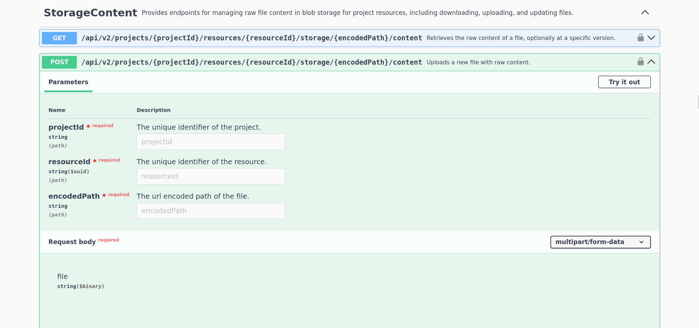
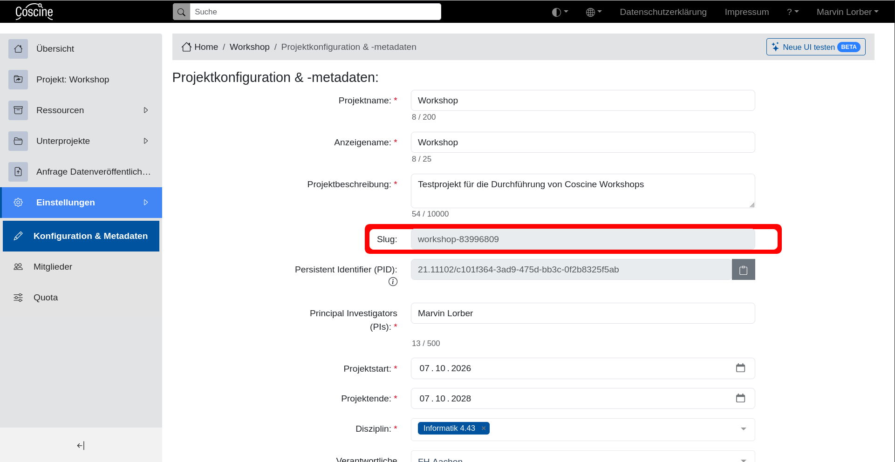
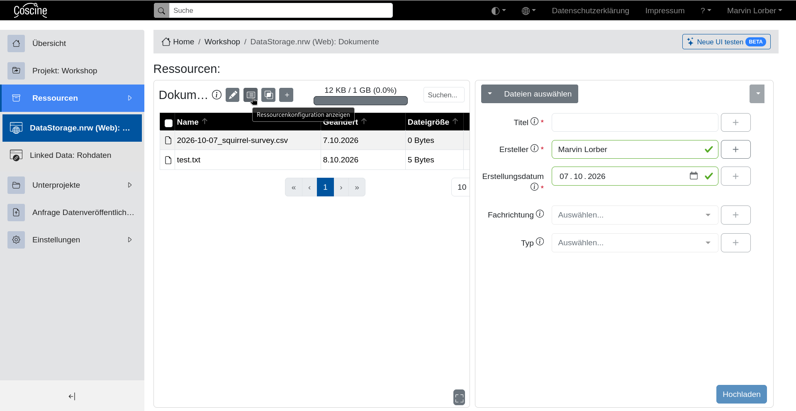
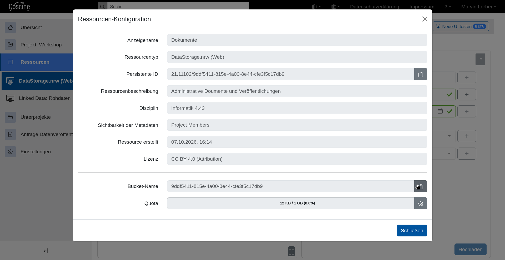
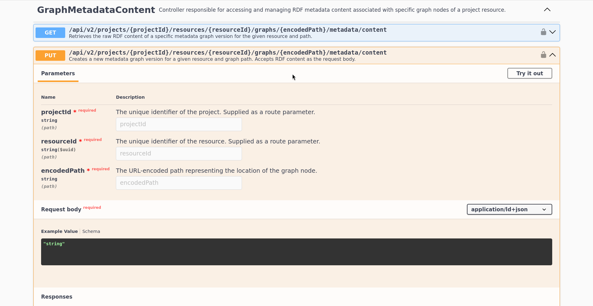
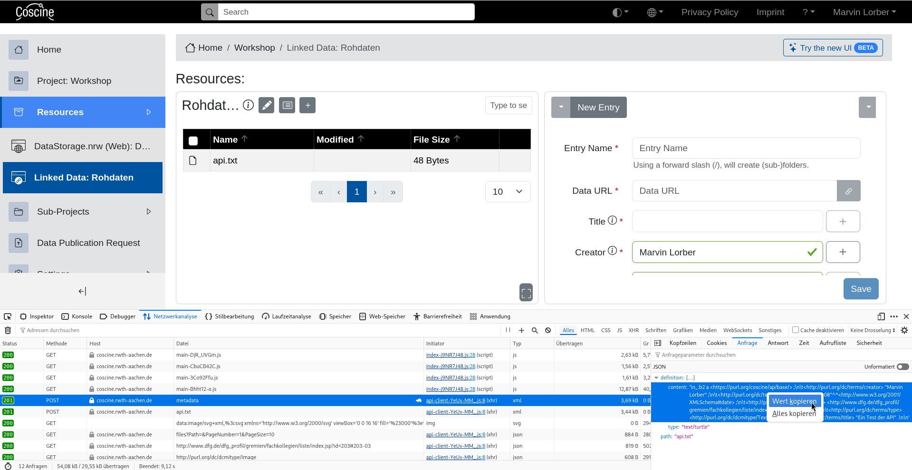

:::::::::::::::::::::::::::::::::::::: questions 

- Wie können Dateien mit programmatisch verändert und beschrieben werden?

::::::::::::::::::::::::::::::::::::::::::::::::

::::::::::::::::::::::::::::::::::::: objectives

- Lade eine Datei mithilfe eines Skripts hoch.
- Ändere die Metadaten einer Datei mithilfe der API.

::::::::::::::::::::::::::::::::::::::::::::::::

## Zugriffstoken

Um die API von Coscine nutzen zu können wird ein persönliches Zugriffstoken benötigt.
Die Token können im Nutzendenprofil unter "Zugriffstoken erstellen" angelegt werden.

::: callout

Ein Zugriffstoken funktioniert wie ein zweites Password für ihren Account und sollte entsprechend geschützt werden.
Löschen Sie Token, die Sie nicht länger benötigen. 

:::

Der Name des Tokens wird nur benötigt, damit Sie ihre Token identifizieren können. Es wird generell empfohlen ein Token pro Projekt / Anwendungsfall anzulegen und spätestens mit dem Projektende ablaufen zu lassen. 

Nach der Erstellung wird ihnen das Token angezeigt. Wichtig: Dies ist die einzige Gelegenheit das Token einzusehen, daher sollten Sie es sicher (z.B. in einem Passwortmanager) abspeichern.

## API Anfragen mit Swagger Doku & curl

Die Coscine API verfügt gleich über zwei interaktive Dokumentationen: [Swagger](https://coscine.rwth-aachen.de/coscine/api/swagger/index.html) und [Scalar](https://coscine.rwth-aachen.de/coscine/apps/apidocs/). Die folgenden Beschreibungen beziehen sich auf die Swagger Dokumentation, sollten sich jedoch nicht wesentlich von der anderen Variante unterscheiden.
Mit der API können alle Aktionen durchgeführt werden die ihnen auch in der Weboberfläche zur Verfügung stehen. In diesem Workshop werden wir uns auf das Hoch- und Herunterladen von Dateien konzentrieren.

Zuerst benötigen wir eine Datei mit etwas Inhalt:
```text
Dies ist eine Testdatei.
```
Dann suchen wir den richtigen Endpunkt in der Swagger Dokumentation. Die relevante Gruppe heißt "StorageContent" wir müssen also etwas scrollen oder mit der Suche (`Strg+f`) an die richtige Stelle springen.

{alt="Screenshot der Swagger Doku mit dem Endpunkt zum Upload"}

Zuerst müssen wir uns authentifizieren, was über das Schloss-Symbol in der oberen rechten Ecke der Box möglich ist. In den folgenden Dialog müssen wir das Wort `Bearer` und ein Leerzeichen und dann unser Zugriffstoken eingeben. Beispiel: `Bearer eyJhb....`.

::: callout
Wenn sie sich im selben Browser bereits in der Coscine Weboberfläche angemeldet haben ist die Authentifizierung nicht zwingend nötig. Allerdings funktionieren die erzeugten curl Befehle dann nicht im lokalen Terminal weil die Autorization-Header fehlen.
:::

Danach kann mit dem Knopf "Try it out" der interaktive Modus gestartet werden.

Der Endpunkt benötigt vier Parameter:

1. **projectId**  
Dieser Parameter, genau wie die resourceId danach könnte mithilfe von anderen API Endpunkten herausgefunden werden. Für den Moment ist es aber einfacher beide Werte aus der Weboberfläche herauszusuchen. Die projectId kann in den Projekteinstellungen unter der Bezeichnung `Slug` gefunden werden.
{alt="Screenshot der Projekteinstellungen mit markiertem project-slug"}

2. **resourceId**  
Dieser Parameter kann in der Weboberfläche unter "Ressourcenkonfiguration anzeigen" > "Bucket-Name" gefunden werden:
{alt="Screenshot der Ressourcenübersicht mit markiertem Konfiguration anzeigen"}
{alt="Screenshot der Ressourcenkonfiguration mit markiertem Bucket-Name"}

3. **encodedPath**  
Der Pfad unter dem die Datei in der Coscine-Ressource gespeichert werden soll in URL-Codierung. Wenn sie gezwungen sind Sonderzeichen in den Dateipfaden zu verwenden sollten Sie dafür einen online URL-Encoder nutzen. Wenn Sie nur Buchstaben, Zahlen und Leerzeichen verwenden kann die Codierung auch von Hand durchgeführt werden: Alle `/` müssen mit `%2F` und alle Leerzeichen mit `%20` ersetzt werden. Aus `test/Test Datei.txt` würde also `test%2FTest%20Datei.txt`.

4. **Die Datei die hochgeladen werden soll**

Anschließend können wir die Anfrage mit "Execute" absenden.
Daraufhin erscheint eine Box mit einem curl-Befehl mit dem wir die selbe Anfrage von einem lokalen Terminal aus erzeugen können. Auf diese Weise können wir aus verschiedenen Anfragen ein Script für komplexere Abläufe erstellen.

Darunter ist die Box mit der Antwort des Servers. **Wir haben eine Fehlermeldung erhalten!**

```json
{
  "data": {
    "type": "https://tools.ietf.org/html/rfc7231#section-6.5.1",
    "title": "Bad Request",
    "status": 400,
    "instance": "/api/v2/projects/{projectId}/resources/{resourceId}/storage/test.txt/content",
    "httpMethod": "POST",
    "errorId": "MissingMetadataBadRequestException"
  },
  "statusCode": 400,
  "isSuccess": false,
  "traceId": "XXXXXXX:00000",
  "pagination": null,
  "categories": null
}
```

:::callout
Auch bei Verwendung der API stellt Coscine sicher, dass für jede Datei Metadaten hochgeladen werden. Wir müssen erst die Metadaten für den Zielpfad und dann die Datei selbst hochladen.
:::

### Hochladen von Metadaten

Für das Hochladen von Metadaten wird ein Endpunkt der Gruppe "GraphMetadataContent" benötigt. Die Benennung kommt daher, dass aus allen Metadaten in Coscine ein Wissensgraph erstellt wird, der mit diesen Endpunkten verändert wird.

{alt="Screenshot der Swagger Doku mit dem Endpunkt zum Upload von Metadaten"}

Die ersten drei Parameter können wir eins-zu-eins vom Endpunkt zum Upload der Datei übernehmen, der vierte ist etwas komplizierter.
Hier benötigen wir die Metadaten für die Datei, wie sie im Metadatenprofil der Zielressource vorgegeben sind und nach `ld+json` oder `turtle` formatiert.
Auch hier wäre es theoretisch möglich die benötigten Informationen mit mehreren Anfragen an die API zusammenzusetzen, in der Praxis ist das allerdings viel zu aufwändig. Daher helfen wir uns auch hier durch kreative Nutzung der Weboberfläche aus. 

Wir starten den Prozess eine Datei (oder Metadaten im falle einer LinkedData Ressource) Hochzuladen und öffnen vor dem Absenden die Entwicklerwerkzeuge des Browsers (Bei den meisten Browsern `F12`) und wählen das Tool "Netzwerkanalyse" (Der genaue Name hängt vom Browser ab).

Dann laden wir die Datei hoch. In der Netzwerkanalyse sollte jetzt ein `POST` mit den Metadaten auftauchen. Aus der Anfrage dieses Eintrag können wir uns die benötigten Daten heraus kopieren:

{alt="Screenshot der Entwicklerwerkzeuge aus Firefox"}

Auf Basis dieser Beispieldaten kann in der Regel leicht von Hand ein neuer Metadatensatz erstellt werden.

```turtle

_:b2 a <https://purl.org/coscine/ap/base/> ;
	<http://purl.org/dc/terms/creator> "Marvin Lorber" ;
	<http://purl.org/dc/terms/created> "2026-10-08"^^<http://www.w3.org/2001/XMLSchema#date> ;
	<http://purl.org/dc/terms/subject> <http://www.dfg.de/dfg_profil/gremien/fachkollegien/liste/index.jsp?id=203#203-03> ;
	<http://purl.org/dc/terms/type> <http://purl.org/dc/dcmitype/Text> ;
	<http://purl.org/dc/terms/title> "Ein Test der API" .


```

Jetzt können wir die Metadaten auch über die API hochladen, für den "Request Body" muss in Swagger `text/turtle` ausgewählt werden. Beachten Sie, dass falls für den angegebenen Pfad bereits Metadaten existieren diese "still" mit einer neuen Version überschrieben werden.

Anschließend können wir auch die Datei selbst über die API hochladen. Dafür können wir dieses Mal der curl Befehl nutzen der uns beim ersten Versuch generiert wurde. Dafür muss gegebenenfalls der Pfad in der letzten Zeile angepasst werden, damit er auf die Datei auf unserer Festplatte zeigt.

```bash
curl -X 'POST' \
  'https://coscine.rwth-aachen.de/coscine/api/v2/projects/{projectId}/resources/{resourceId}/storage/test.txt/content' \
  -H 'accept: */*' \
  -H 'Authorization: Bearer [Token]' \
  -H 'Content-Type: multipart/form-data' \
  -F 'file=@test.txt;type=text/plain'
```

### Herunterladen von Dateien

Zeit die neu erstellte Datei herunterzuladen. Dafür benötigen wir wieder einen Endpunkt aus der Gruppe "StorageContent". Die drei benötigten Parameter können wir von unseren bisherigen Anfragen übernehmen.

Wenn wir den generierten curl Befehl lokal ausführen wird uns der Inhalt der Datei im Terminal ausgegeben. Um den Inhalt direkt in eine Datei umzuleiten können wir die `-o` Option nutzen.

```bash
curl -X 'GET' \
  'https://coscine.rwth-aachen.de/coscine/api/v2/projects/{projektId}/resources/{resourceId}/storage/test.txt/content' \
  -H 'accept: application/octet-stream' \
  -H 'Authorization: Bearer [Token]' \
  -o test.txt
```

::::::::::::::::::::::::::::::::::::::: challenge
Diese Challenge erfordert grundlegende Kenntnisse in der Programmierung mit Bash.
Sie haben einen Algorithmus entwickelt um die Beobachtungsprotokolle automatisiert zu annotieren. Um die Verarbeitung auf einem Rechencluster durchführen zu können müssen Sie Herunter- und Hochladen von Dateien automatisieren.   
Schreiben Sie ein Skript um alle obs_\*\*\*.csv über die API herunterzuladen und anschließend annotiert_obs_\*\*\*.csv mit passenden Metadaten hochzuladen.

:::::::::::::::  solution

```bash
#!/usr/bin/env bash

API_TOKEN="${COSINE_API_TOKEN:?Setze die Umgebungsvariable COSINE_API_TOKEN}"
BASE_URL="https://coscine.rwth-aachen.de/coscine/api/v2"

# ============================================================
#  Liste der zu ladenden Dateien
#  Format: "projektId|resourceId|filename"
# ============================================================
FILES=(
    "12345|67890|obs_2025-01-15_brunnen.csv"
    "12345|67890|obs_2025-01-15_rathausdach.csv"
    "23456|78901|obs_2025-01-15_baeckerei.csv"
)

# ============================================================
#  Hilfsfunktionen
# ============================================================

download_file() {
    local projekt_id="$1"
    local resource_id="$2"
    local filename="$3"

    local url="${BASE_URL}/projects/${projekt_id}/resources/${resource_id}/storage/${filename}/content"
    local dest="./${filename}"

    curl -X GET -o "$dest" \
        -H "Authorization: Bearer ${API_TOKEN}" \
        -H "Accept: application/octet-stream" \
        "$url"
}

upload_metadata() {
    local projekt_id="$1"
    local resource_id="$2"
    local filename="$3"

    local dest="annotiert_$(jq -rn --arg x ${filename} '$x|@uri')"
    local url="${BASE_URL}/projects/${projekt_id}/resources/${resource_id}/graphs/${dest}/metadata/content"
    
    local metadata="
_:b2 a <https://purl.org/coscine/ap/base/> ;
	<http://purl.org/dc/terms/creator> \"Ihr Name\" ;
	<http://purl.org/dc/terms/created> \"$(date -I)\"^^<http://www.w3.org/2001/XMLSchema#date> ;
	<http://purl.org/dc/terms/subject> <http://www.dfg.de/dfg_profil/gremien/fachkollegien/liste/index.jsp?id=203#203-03> ;
	<http://purl.org/dc/terms/type> <http://purl.org/dc/dcmitype/Dataset> ;
	<http://purl.org/dc/terms/title> \"Automatisch annotierte version von $filename\" .

"

    curl -X PUT "$url" \
        -H "Authorization: Bearer ${API_TOKEN}" \
        -H "Accept: */*" \
        -H "Content-Type: text/turtle" \
        -d '${metadata}'
        
}

upload_file() {
    local projekt_id="$1"
    local resource_id="$2"
    local filename="$3"

    local dest="annotiert_$(jq -rn --arg x ${filename} '$x|@uri')"
    local url="${BASE_URL}/projects/${projekt_id}/resources/${resource_id}/storage/${dest}/content"
 
    curl -X POST "$url" \
        -H "Authorization: Bearer ${API_TOKEN}" \
        -H "Accept: */*" \
        -H "Content-Type: multipart/form-data" \
        -F "file=@annotiert_${filename};type=text/plain"
        
}


for entry in "${FILES[@]}"; do
    IFS='|' read -r projekt_id resource_id filename <<< "$entry"

    download_file "$projekt_id" "$resource_id" "$filename"
    touch "annotiert_${filename}"
    upload_metadata "$projekt_id" "$resource_id" "$filename"
    upload_file "$projekt_id" "$resource_id" "$filename"
done


```

:::::::::::::::::::::::::

::::::::::::::::::::::::::::::::::::::::::::::::::


::::::::::::::::::::::::::::::::::::::::: keypoints

- Für die Verwendung der API muss ein Zugriffstoken angelegt werden
- Über die interaktive Dokumentation können Anfragen generiert werden. [Swagger](https://coscine.rwth-aachen.de/coscine/api/swagger/index.html), [Scalar](https://coscine.rwth-aachen.de/coscine/apps/apidocs/)
- Metadaten müssen vor den Daten hochgeladen werden

:::::::::::::::::::::::::::::::::::::::::::::::::::
